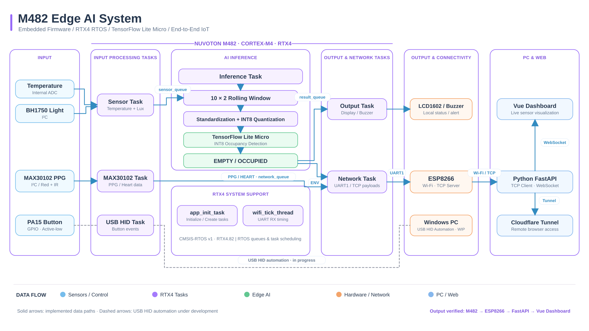

# M482 Edge AI System

An embedded Edge AI system developed using the Nuvoton M482 microcontroller.

The project integrates real-time sensor acquisition, TensorFlow Lite Micro inference, RTX4 multitasking, USB HID, and ESP8266 Wi-Fi communication.

## Features

- Nuvoton M482 (ARM Cortex-M4)
- CMSIS-RTOS v1 / RTX4
- TensorFlow Lite Micro (INT8 inference)
- Temperature and light sensor acquisition
- Occupancy detection (EMPTY / OCCUPIED)
- ESP8266 Wi-Fi TCP communication
- USB HID keyboard development
- LCD1602 display and buzzer control

## Firmware Architecture

- Sensor Task: Acquires temperature and light data
- Inference Task: Runs INT8 Edge AI inference
- Network Task: Handles ESP8266 TCP communication
- Output Task: Updates LCD and buzzer outputs
- USB HID Task: Monitors PA15 button input

## Development Environment

- Keil MDK-ARM
- Arm Compiler 6
- CMSIS-RTOS v1 / RTX4.82
- Nuvoton M480 Device Support
- TensorFlow Lite Micro

## Build Instructions

1. Install Keil MDK-ARM and the required CMSIS and Nuvoton device packs.
2. Open the project:

   MyAPP/Sideproject/GPIO_OutputInput/KEIL/GPIO_OutputInput.uvprojx

3. Copy `wifi_secrets.example.h` to `wifi_secrets.h` in the KEIL directory.
4. Configure your local Wi-Fi credentials.
5. Rebuild the project using Keil.

## Security

Wi-Fi credentials are stored in a local
`wifi_secrets.h` file, which is excluded
from Git version control.

## Project Status

- M482 firmware: Build verified
- Edge AI inference: Integrated
- ESP8266 communication: Integrated
- USB HID automation: Under development

## Third-Party Dependencies

This project uses components from Nuvoton,
Arm CMSIS, TensorFlow Lite Micro, and
other third-party libraries.

Third-party components remain subject to
their respective licenses.

## System Architecture

